# Customer Churn Prediction - Production Flask Dashboard

[](https://flask.palletsprojects.com/)
[](https://vercel.com)
[](https://github.com/Ansh-0815/customer-churn-prediction)

An end-to-end Machine Learning & Web Production System built with **Flask**, **Vercel Serverless**, **MLflow**, and **Scikit-Learn** that predicts telecom customer churn in real time and provides an executive intelligence dashboard with automated retraining and an extended EDA notebook study.

---

## Application Screenshots (Captured from Web Dashboard)

### 1. Executive Churn Dashboard (`/`)
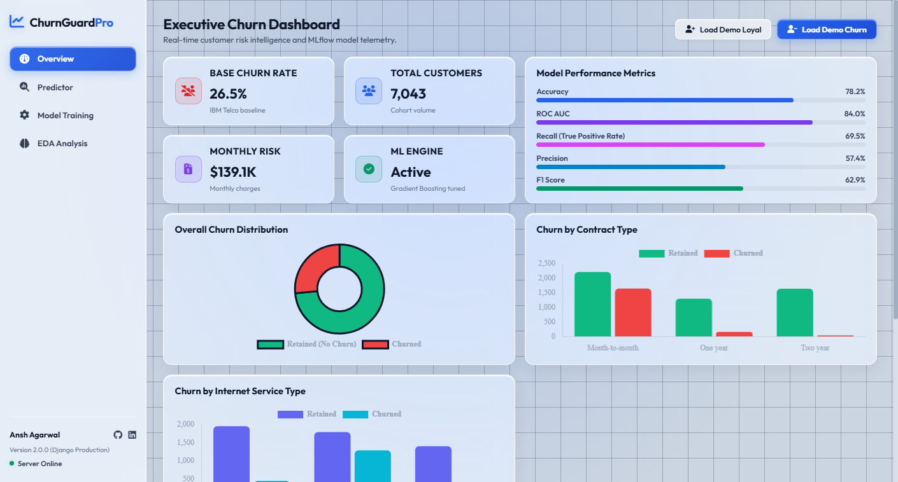

### 2. Customer Churn Predictor (`/predict`)
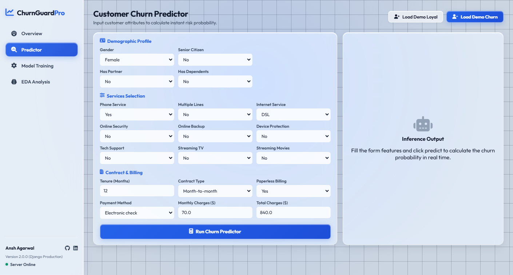

### 3. Model Retraining Console (`/train`)
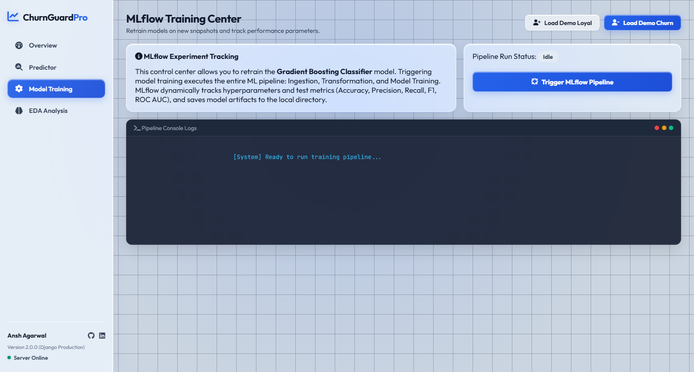

### 4. Extended Exploratory Data Analysis & Feature Exploration (`/eda`)
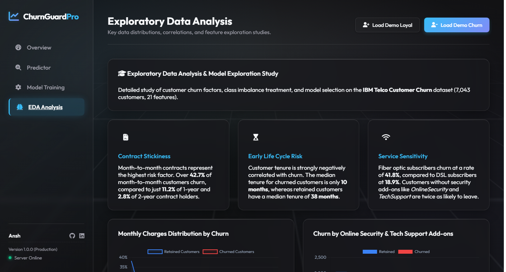

---

## Extended Exploratory Data Analysis & Notebook Charts

Extracted directly from [`notebook/churn_prediction.ipynb`](notebook/churn_prediction.ipynb):

| Chart 1: Churn Class Distribution | Chart 2: Churn by Contract Type |
| :---: | :---: |
| 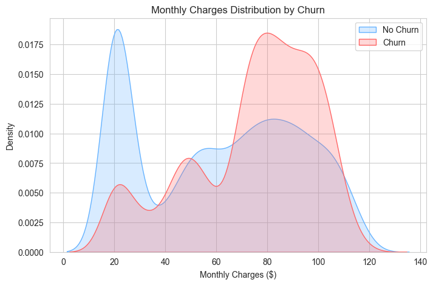 | 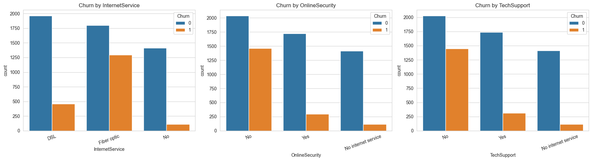 |

| Chart 3: Tenure Cohort Distribution | Chart 4: Monthly Charges vs Churn |
| :---: | :---: |
| 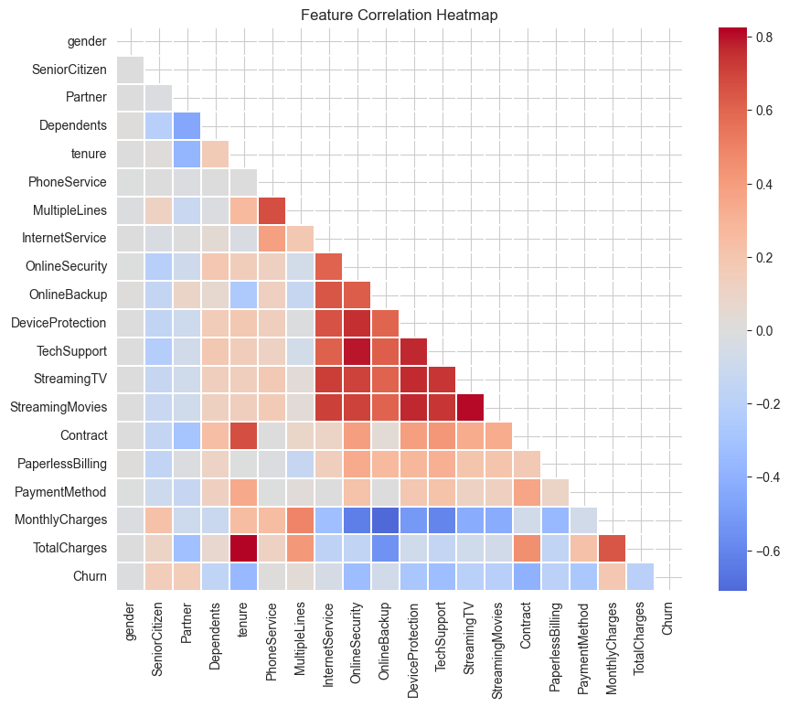 | 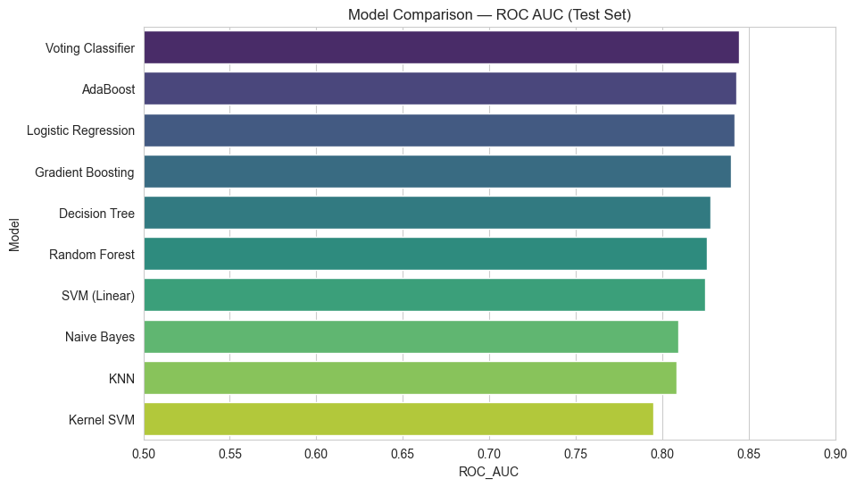 |

| Chart 5: Internet Service Churn | Chart 6: 10-Model Benchmark |
| :---: | :---: |
| 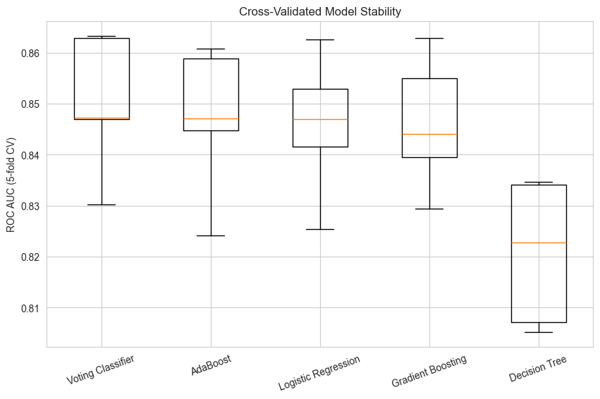 | 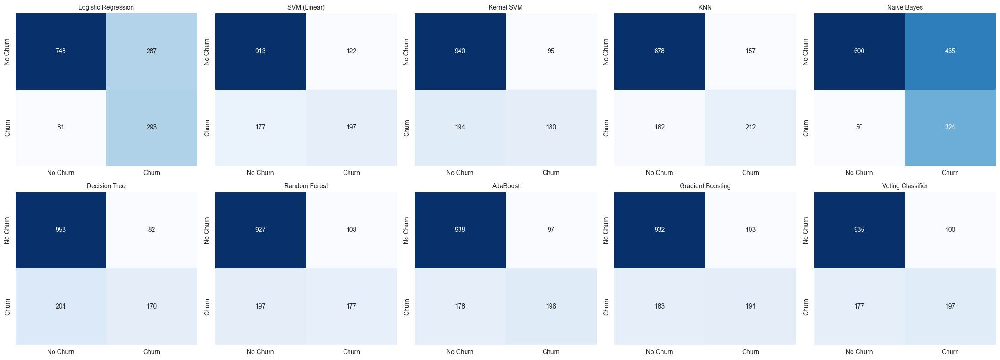 |

| Chart 7: Effect of SMOTE | Chart 8: Top Churn Drivers |
| :---: | :---: |
| 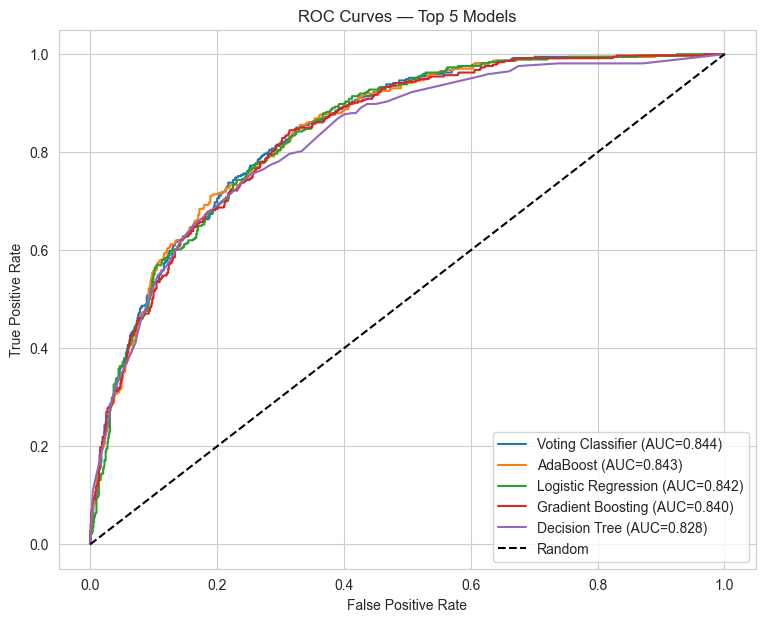 | 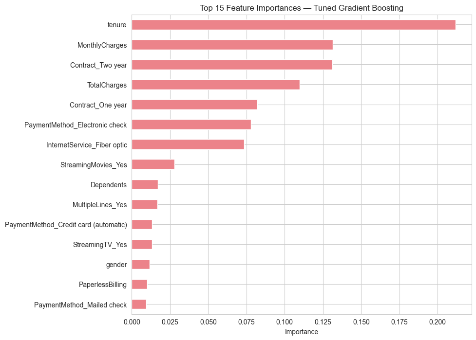 |

---

## Executive Summary

- **Flask Microservices Architecture**: Built with Flask, featuring ultra-fast response times, lightweight serverless architecture for Vercel deployment, semi-transparent frosted acrylic surfaces (`backdrop-filter: blur(18px) saturate(190%)`), inset glass highlights, flat 2D vector grid canvas, and real-time risk scoring.
- **Vercel Serverless Deployment**: Configured via `vercel.json` and `api/index.py` (Python 3.12) so the whole dashboard and prediction API run as a single serverless function.
- **Extended EDA Analysis & Correlation Matrix**: Features a Pearson feature correlation heatmap matrix, 10-model benchmark comparison table, SMOTE oversampling treatment matrix, and service security stickiness analytics.
- **Instant Risk Predictor**: Form-driven REST API (`/predict`) providing instant single-customer churn risk scoring and circular SVG risk-meter visualization.
- **Live Retraining**: Trigger model retraining directly from the UI (`/train`). Locally it runs `main.py` in the background with MLflow tracking and streams logs via Server-Sent Events (`/train/stream`). On Vercel it runs in a temporary demo mode inside the request (a few seconds) and the result is not saved permanently.
- **Embedded Jupyter Notebook Study**: Renders the project's exploratory data analysis and model comparison notebook (`notebook/churn_prediction.ipynb`) into static HTML (`/notebook`).
- **ML Model Performance**: Evaluated 10 classification algorithms; tuned **Gradient Boosting Classifier** with **SMOTE** oversampling to achieve high recall on churners while maintaining **ROC AUC ≈ 0.84**.

---

## Architecture & Project Structure

```
customer-churn-prediction/
├── app.py                      # Flask application (routes, validation, training control)
├── api/index.py                # Vercel serverless entrypoint (imports the Flask app)
├── main.py                     # CLI entrypoint to retrain the model locally
├── vercel.json                 # Vercel function settings and routing
├── .vercelignore               # Keeps notebooks and MLflow runs out of the deployment
├── .python-version             # Python 3.12 for Vercel
├── Procfile                    # Gunicorn entrypoint for non-Vercel hosts
├── requirements.txt            # Pinned runtime dependencies (used by Vercel)
├── requirements-train.txt      # Runtime plus MLflow for local training
│
├── src/customer_churn_prediction/
│   ├── config.py               # Paths and serverless detection
│   ├── utils.py                # save_object / load_object helpers
│   ├── components/
│   │   ├── data_ingestion.py        # Loads raw CSV and splits train/test
│   │   ├── data_transformation.py   # Imputation, encoding, scaling, SMOTE
│   │   ├── model_tranier.py         # Gradient Boosting training, optional MLflow logging
│   │   └── model_monitering.py      # Basic data quality checks
│   └── pipelines/
│       ├── training_pipeline.py     # End-to-end retraining
│       └── prediction_pipeline.py   # Input validation and scoring
│
├── data/Telco-Customer-Churn.csv    # IBM Telco dataset (7,043 customers)
├── models/                     # churn_model.pkl, scaler.pkl, model_columns.pkl, metrics.json, feature_importance.json
├── templates/                  # index.html (dashboard), notebook.html (rendered notebook)
├── static/                     # style.css, script.js, assets/
└── notebook/churn_prediction.ipynb  # EDA and model comparison notebook
```

Generated files (`artifacts/`, `mlruns/`, `mlflow.db`) are created locally by `python main.py` and are git-ignored.

---

## Deploying to Vercel

1. Push this repository to GitHub.
2. On vercel.com choose **Add New > Project**, import the repository and click **Deploy**. No settings need to be changed.
3. Or use the CLI: `npm i -g vercel` then `vercel --prod`.

Vercel reads `vercel.json`, installs the pinned packages from `requirements.txt` (Python 3.12 from `.python-version`) and serves the Flask app through `api/index.py`.

Notes:
- The saved model was trained with scikit-learn 1.7.2, so `requirements.txt` pins that exact version. If you change it, retrain first.
- On Vercel the **Trigger MLflow Pipeline** button runs a temporary demo retrain (a few seconds). The new model lives in `/tmp` and disappears when the function instance recycles. To make a retrain permanent, run `python main.py` locally, commit the updated `models/` folder and redeploy.
- `GET /health` returns `{"status": "ok"}` for uptime checks.

---

## Running Locally

```bash
python -m venv venv
source venv/bin/activate        # Windows: venv\Scripts\activate
pip install -r requirements.txt
python app.py
```

Open [http://localhost:5000](http://localhost:5000). Set `FLASK_DEBUG=1` for auto-reload.

## Retraining Locally (with MLflow tracking)

```bash
pip install -r requirements-train.txt
python main.py
```

This rewrites everything in `models/` and logs the run to `mlflow.db`. Browse runs with `mlflow ui --backend-store-uri sqlite:///mlflow.db`.

## API

| Endpoint | Method | Description |
| --- | --- | --- |
| `/` | GET | Dashboard |
| `/predict` | POST | JSON customer record in, churn prediction and probability out (400 on invalid input) |
| `/metrics` | GET | Latest model metrics |
| `/feature_importance` | GET | Top 5 feature importances |
| `/train` | POST | Retrain the model (background locally, demo mode on Vercel) |
| `/train/stream` | GET | Server-Sent Events log stream (local only) |
| `/notebook` | GET | Rendered EDA notebook |
| `/health` | GET | Health check |
